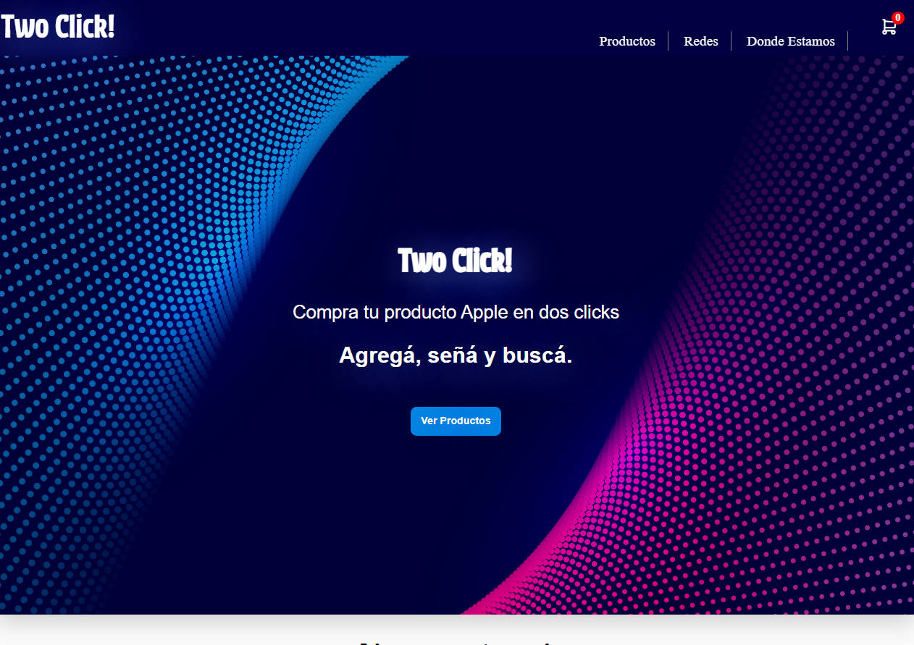
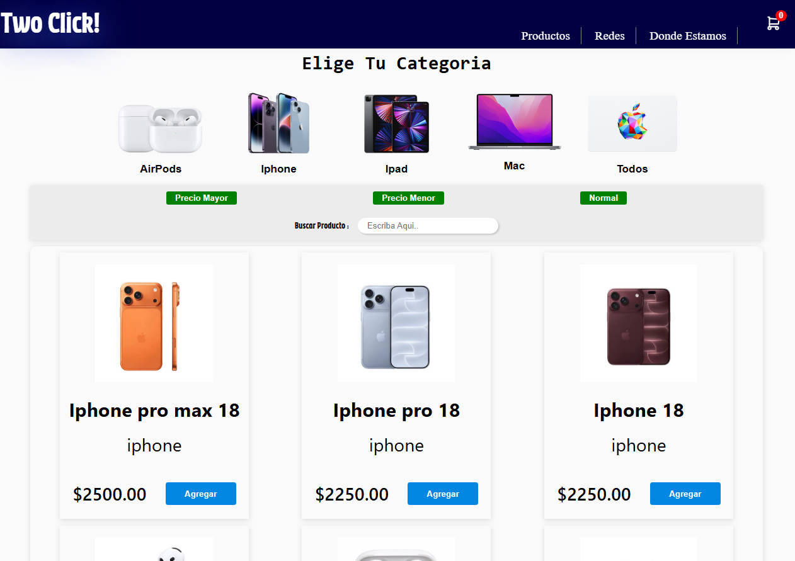
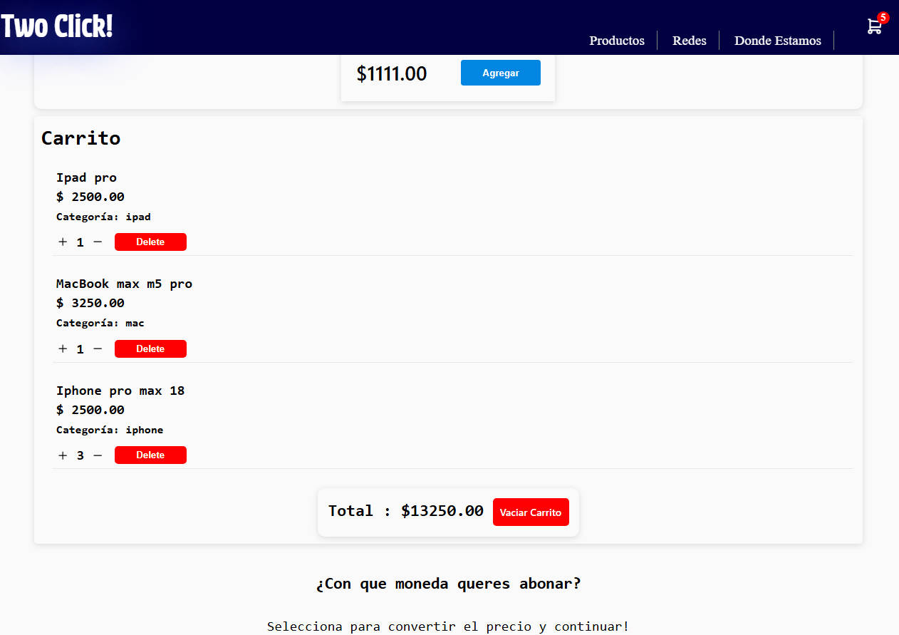
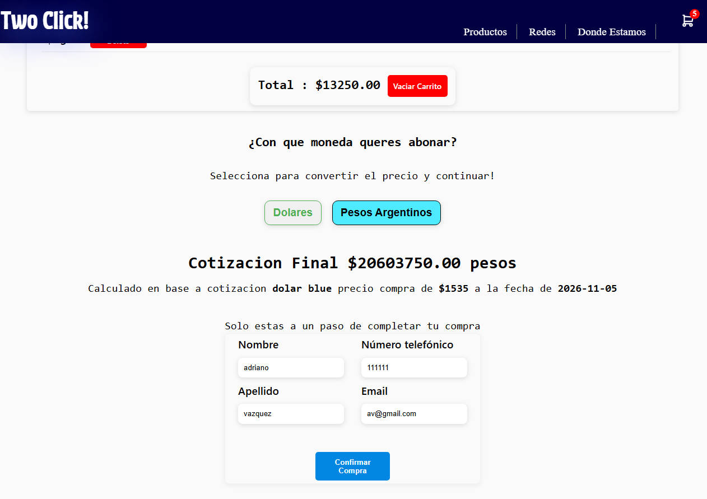
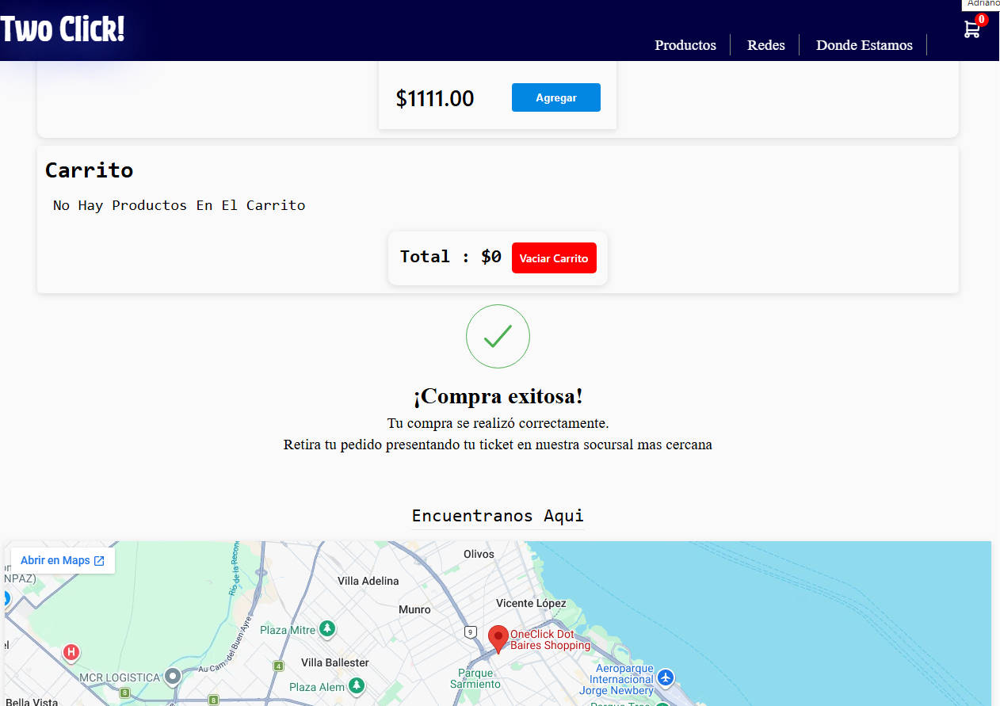
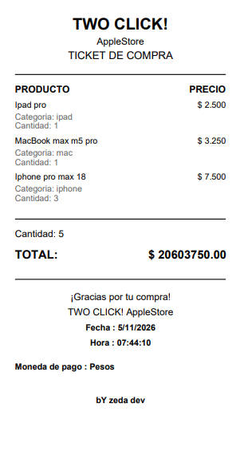
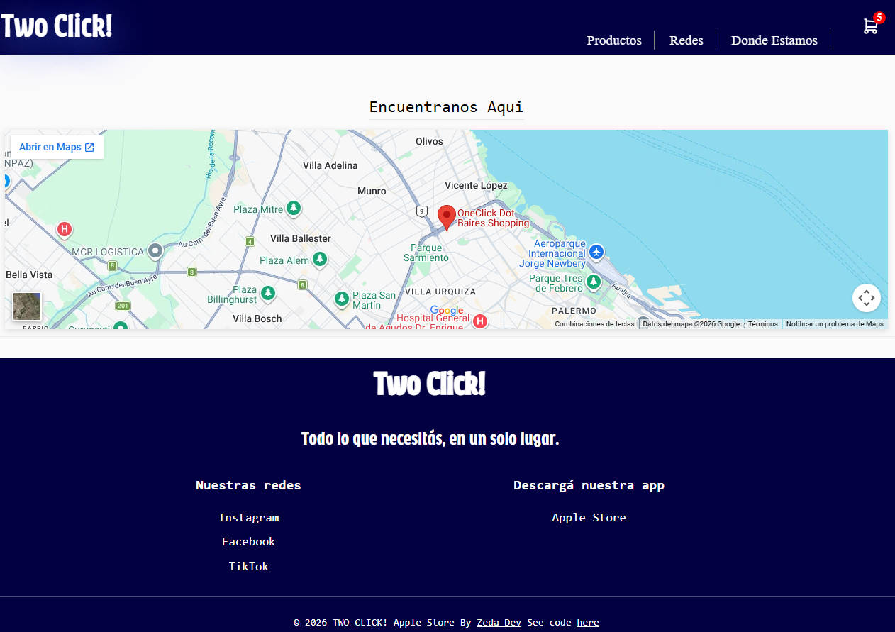

# Two Click - Apple Store

**E-commerce landing page**

HTML / CSS / Vainilla JavaScript / Fetch API / jsPDF

Link directo : [TwoClickStore](https://avtwoclickstore.vercel.app/)

- https://avtwoclickstore.vercel.app/
---

**Repositorio Backend:** [Two Click - Backend](https://github.com/a11vazquez/admin-backend)

**API REST:** [Two Click API](https://two-click-panel-admin.vercel.app)

- https://two-click-panel-admin.vercel.app/api/products

---

## Características

- **Responsive:** totalmente adaptable a celulares y, otras pantallas.
- **Visualización de productos:** Obtención dinámica de productos mediante solicitudes Fetch a una API REST.
- **Búsqueda por nombre:** Campo de búsqueda para encontrar productos según su nombre.
- **Contador del carrito:** Actualización dinámica de la cantidad de productos agregados al carrito.
- **Generación de tickets PDF:** Al confirmar una venta, se genera y descarga un comprobante en formato PDF mediante **jsPDF**.
- **Cotización del dólar:** Consulta del valor del dólar mediante una API de cotización.
- **Filtro por categoría:** Filtrado de productos según su categoría.
- **Filtro por precio:** Filtrado de productos según su precio.
---

## Integración con Backend

Consume una API REST desarrollada con Node.js y Express, encargada de gestionar los productos y registrar las ventas.

**Repositorio Backend:** [Two Click - Admin Backend](https://github.com/a11vazquez/admin-backend)

**API REST:** https://two-click-panel-admin.vercel.app

---

# Screenshots

## Inicio

---
## Productos

---
## Carrito

---
## Venta

---
## Venta Exitosa

---
## TICKET PDF

---
## FOOTER

